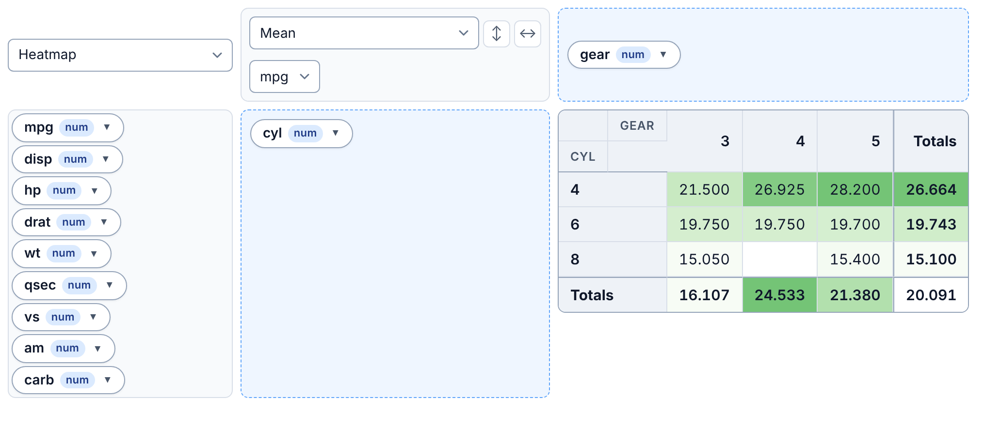

# Getting started with safePivot

## Overview

`safePivot` provides a safe drag-and-drop pivot table htmlwidget for R
and Shiny. It wraps PivotTable.js with robust numeric aggregators,
missing-value summaries, zero-value summaries, factor-order
preservation, heatmaps, lightweight Plotly chart renderers, Shiny
configuration capture, and export helpers.

The package is designed for data exploration workflows where users need
to distinguish:

- empty row-column combinations
- observed missing values
- observed zero values
- positive and non-zero measured values

This distinction is important for scientific and agricultural datasets,
where a missing measurement, a zero measurement, and a non-existing
row-column combination have different meanings.

## Basic pivot table

``` r

library(safePivot)

res <- safe_pivot_compute(
  iris,
  rows = "Species",
  vals = "Sepal.Length",
  aggregator = "Median"
)

res$wide
#>      Species .value
#> 1     setosa    5.0
#> 2 versicolor    5.9
#> 3  virginica    6.5
```

## Interactive widget

The interactive widget is usually run in the RStudio Viewer, a browser,
R Markdown, or Shiny.

``` r

safePivot(
  iris,
  rows = "Species",
  vals = "Sepal.Length",
  aggregator = "Median",
  renderer = "Table"
)
```


safePivot table: Species in rows, median Sepal.Length per species

Drag variables between the unused list, the rows area (left) and the
columns area (top); pick the aggregator and value variable at top left.

## Heatmap

SafePivot supports table-style heatmaps:

``` r

safePivot(
  mtcars,
  rows = "cyl",
  cols = "gear",
  vals = "mpg",
  aggregator = "Mean",
  renderer = "Heatmap",
  heatmap_palette = "green"
)
```



Heatmap of mean mpg by cylinders and gears

Heatmap renderers include:

``` r

"Heatmap"
"Row Heatmap"
"Col Heatmap"
```

Browser-side conditional formatting is intentionally disabled for
heatmap renderers so that the heatmap palette is not overwritten by
SafePivot cell-colour classes.

## Lightweight Plotly charts

SafePivot includes lightweight Plotly chart renderers:

``` r

safePivot(
  mtcars,
  rows = "cyl",
  cols = "gear",
  vals = "mpg",
  aggregator = "Mean",
  renderer = "Bar Chart",
  plot_default_height = 520
)
```


Bar chart of mean mpg by gears, one bar per cylinder count

Supported lightweight chart renderers include:

``` r

"Horizontal Bar Chart"
"Horizontal Stacked Bar Chart"
"Bar Chart"
"Stacked Bar Chart"
"Line Chart"
"Area Chart"
"Scatter Chart"
"Multiple Pie Chart"
```

Treemap is intentionally not included in the core package because it
requires a larger Plotly bundle and custom hierarchy handling.

## Missing values and zero values

SafePivot includes data-quality aggregators:

``` r

"N missing"
"N non-missing"
"Missing % within Cell"
"Non-missing % within Cell"
"N zero"
"N non-zero"
"Zero % within Cell"
"Non-zero % within Cell"
```

Example data:

``` r

dat <- data.frame(
  treatment = c("A", "A", "B", "B", "C", "C"),
  season = c("Spring", "Summer", "Spring", "Summer", "Spring", "Summer"),
  yield = c(10, NA, 0, 12, 15, NA)
)

safe_pivot_compute(
  dat,
  rows = "treatment",
  cols = "season",
  vals = "yield",
  aggregator = "N missing"
)$wide
#> # A tibble: 3 × 3
#>   treatment Spring Summer
#>   <chr>      <int>  <int>
#> 1 A              0      1
#> 2 B              0      0
#> 3 C              0      1
```

Zero values are counted separately from missing values:

``` r

safe_pivot_compute(
  dat,
  rows = "treatment",
  cols = "season",
  vals = "yield",
  aggregator = "N zero"
)$wide
#> # A tibble: 3 × 3
#>   treatment Spring Summer
#>   <chr>      <int>  <int>
#> 1 A              0      0
#> 2 B              1      0
#> 3 C              0      0
```

In the widget, conditional formatting marks these cases directly in the
table:

``` r

quality_dat <- data.frame(
  row = c("A", "A", "A", "B", "B", "C"),
  col = c("X", "X", "Y", "X", "Y", "X"),
  y = c(0, 1, NA, 0, 5, NA)
)

safePivot(
  quality_dat,
  rows = "row",
  cols = "col",
  vals = "y",
  aggregator = "Sum",
  renderer = "Table",
  conditional_format = TRUE,
  conditional_format_mode = "both"
)
```


Conditional formatting: zero cell in yellow, highest value in orange,
empty cells hatched

Zero cells are yellow, the highest values orange, the lowest blue, and
cells with no records are hatched grey.

## Fraction aggregators

SafePivot includes sum and count fraction aggregators:

``` r

"Sum as Fraction of Total"
"Sum as Fraction of Rows"
"Sum as Fraction of Columns"
"Count as Fraction of Total"
"Count as Fraction of Rows"
"Count as Fraction of Columns"
```

For example:

``` r

safe_pivot_compute(
  iris,
  rows = "Species",
  vals = "Sepal.Length",
  aggregator = "Count as Fraction of Total"
)$wide
#>      Species   .value
#> 1     setosa 33.33333
#> 2 versicolor 33.33333
#> 3  virginica 33.33333
```

Each species is one third of the `iris` dataset.

## Factor ordering

SafePivot can respect R factor-level ordering.

``` r

dat2 <- data.frame(
  treatment = factor(
    rep(c("Control", "Low", "Medium", "High"), each = 4),
    levels = c("Control", "Low", "Medium", "High")
  ),
  season = factor(
    rep(c("Spring", "Summer", "Autumn", "Winter"), times = 4),
    levels = c("Spring", "Summer", "Autumn", "Winter")
  ),
  yield = c(10, 11, 12, 13, 14, 15, 16, 17,
            18, 19, 20, 21, 22, 23, 24, 25)
)

safe_pivot_compute(
  dat2,
  rows = "treatment",
  cols = "season",
  vals = "yield",
  aggregator = "Median"
)$wide
#> # A tibble: 4 × 5
#>   treatment Spring Summer Autumn Winter
#>   <fct>      <dbl>  <dbl>  <dbl>  <dbl>
#> 1 Control       10     11     12     13
#> 2 Low           14     15     16     17
#> 3 Medium        18     19     20     21
#> 4 High          22     23     24     25
```

For the interactive widget:

``` r

safePivot(
  dat2,
  rows = "treatment",
  cols = "season",
  vals = "yield",
  aggregator = "Median",
  renderer = "Table",
  respect_factor_order = TRUE
)
```

## Starting filters and layout

Start with some values filtered out, the same way a user would untick
them in a variable’s filter box:

``` r

safePivot(
  iris,
  rows = "Species",
  vals = "Sepal.Length",
  aggregator = "Mean",
  exclusions = list(Species = "setosa")
)
```


Filter box for Species with setosa unticked; the table shows only
versicolor and virginica

`inclusions` works the other way round: only the listed values start
ticked.

For data with many columns, `unused_layout = "auto"` (the default) lists
unused variables in a column on the left instead of a long row above the
table. Use `"left"` or `"top"` to choose.

``` r

safePivot(mtcars, rows = "cyl", cols = "gear", unused_layout = "left")
```


Unused mtcars variables listed in a column on the left of the table

## Export

SafePivot can export computed pivot results.

``` r

res <- safe_pivot_compute(
  iris,
  rows = "Species",
  cols = "Petal.Width",
  vals = "Sepal.Length",
  aggregator = "Median"
)

safe_pivot_write_csv(res, "iris_pivot.csv")
safe_pivot_write_rds(res, "iris_pivot.rds")
safe_pivot_write_rdata(res, "iris_pivot.RData")

# Requires openxlsx
safe_pivot_write_xlsx(res, "iris_pivot.xlsx")
```

## Development checks

Before releasing updates, run:

``` r

devtools::document()
devtools::load_all(reset = TRUE)
devtools::test()
devtools::check()
```
